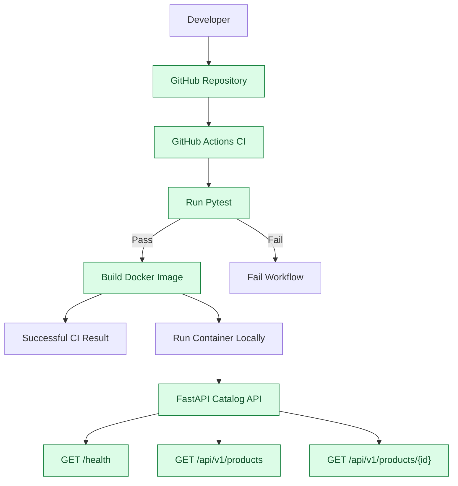

# AegisOps Architecture

This diagram represents the components currently implemented and verified in this repository. Cloud deployment components are not included because their operation has not yet been verified.

## Verified components

- **GitHub:** Source code and workflow version control.
- **GitHub Actions:** Automated API tests and Docker image build.
- **FastAPI:** Catalog API and health endpoint.
- **Pytest:** Automated API tests.
- **Docker:** Containerized application.

## Not yet verified

Terraform-managed Azure infrastructure, AKS deployment, Argo CD reconciliation, and production monitoring remain outside the verified current implementation.

These components should only be added to the implemented architecture after their configuration and operation have been confirmed.
